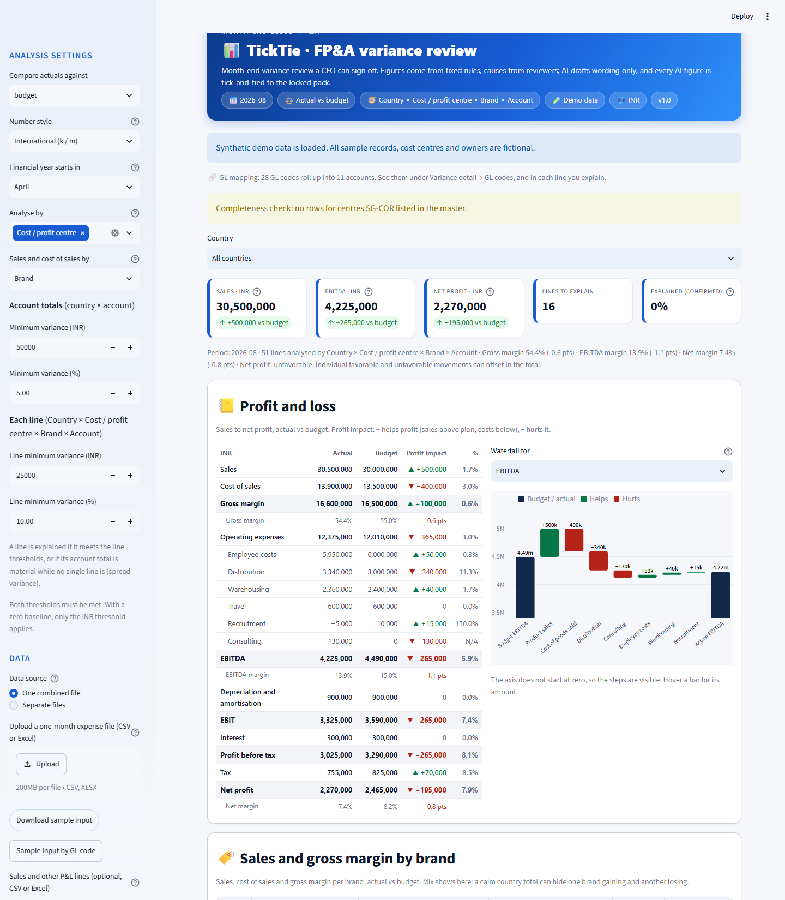
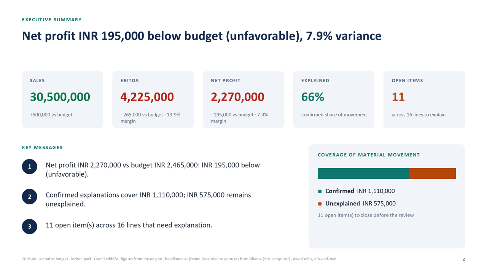
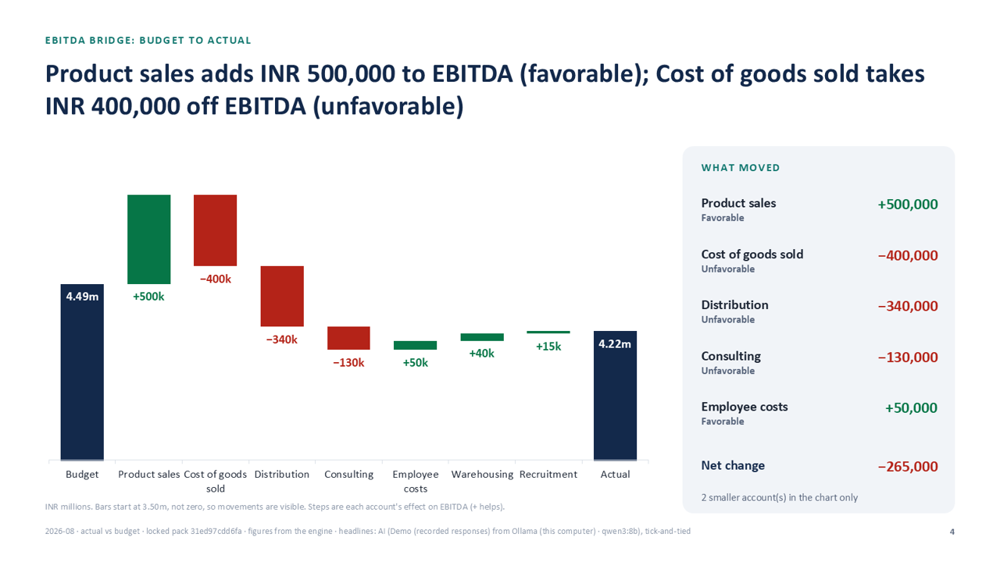
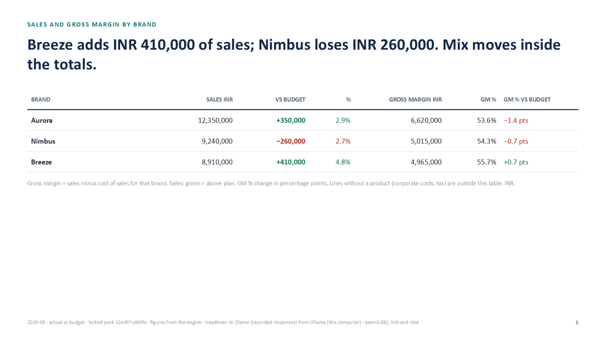
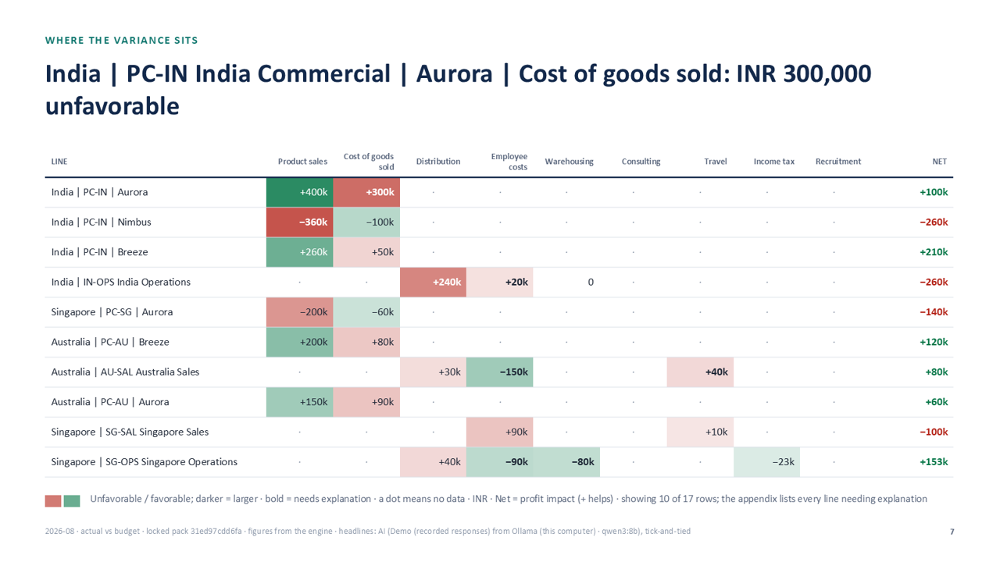
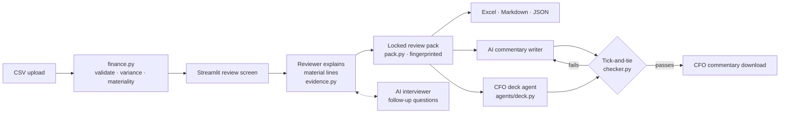

# TickTie: FP&A variance review a CFO can sign off

[](https://github.com/Sai-Fin-AI/ticktie-fpa/actions/workflows/tests.yml)
[](LICENSE)

[](https://ticktie-fpa.streamlit.app)

**Month-end variance analysis that never invents a cause.** Upload actuals, budget and forecast, by GL code, cost centre, profit centre and SKU. The tool validates the data, calculates every variance in exact decimal arithmetic, flags what is material and asks the owners to explain it. Then two AI agents turn the locked review into CFO commentary and a 12-slide PowerPoint deck. **The AI never calculates a figure, and every figure it writes is tick-and-tied back to the locked pack by plain code.**

*Why "TickTie"? To tick and tie is the accountant's check that every figure in a report traces back to its source. Here code does it to every sentence the AI writes.*

## Try it

**[▶ Open the live demo](https://ticktie-fpa.streamlit.app)**. No sign-up and no API key: it runs on synthetic data, with AI answers recorded from a local model and labelled as such. Click **Load demo explanations**, then **Lock review pack**, then **Draft CFO commentary and deck**. The [walkthrough](docs/WALKTHROUGH.md) gives the figures to expect at each step.



| CFO deck: executive summary | CFO deck: EBITDA bridge |
| --- | --- |
|  |  |
| **Sales and gross margin by brand** | **Where the variance sits** |
|  |  |

More screens: [brand mix and heatmap](docs/images/app_brands_heatmap.png) · [explaining a line, with SKU and GL drill-down](docs/images/app_explain.png) · [checked CFO commentary](docs/images/app_commentary.png). The design choices behind it are in the [case study](docs/CASE_STUDY.md).

## What makes it safe to put in front of a CFO

| Risk with AI commentary | Control in this tool |
| --- | --- |
| The AI miscalculates or invents a number | The AI never calculates. A plain-code checker traces every figure in its text to the locked pack (lakh, crore and million included). Text that fails is replaced with engine-written wording. |
| The right number on the wrong line | Each amount must belong to the name just before it. A line listed under "favorable" or "unexplained" must really be favorable or unexplained. |
| An invented cause | Causes come only from reviewers' notes, labelled as supplied. Only *confirmed* notes reduce the unexplained balance. |
| Numbers drift between screen, Excel and slides | One locked, SHA-256 fingerprinted pack feeds every output. Change anything and the exports are withheld until you lock again. |
| Bad data in, confident commentary out | Rule-based data checks run before any calculation: duplicates, missing values, mixed months, unmapped GL codes and SKUs, codes Excel has corrupted. Nothing is assumed or silently merged. |
| Offsetting movements hidden in a net figure | Gross vs net for every account, centre and brand: India sales are +300k net but move 1,020k gross. |

## Why it exists

During monthly reporting, FP&A teams reconcile actuals against budget or the latest forecast, pick out material movements and chase explanations. All of it is done under deadline pressure. The risk is commentary that sounds confident but restates numbers wrongly or guesses at causes. This project makes each step explicit, repeatable and reviewable.

## What it does (full list)

- **Validates before it calculates.** Missing values, duplicate keys, wrong currency, malformed amounts and mixed months stop the analysis. Nothing is assumed.
- **Negative balances handled, not hidden.** Credit notes, reversals and recoveries are accepted. A line that nets below zero (demo: India Recruitment at INR −5,000 after an agency credit note) is flagged ⚠ on screen, in the Excel pack, the commentary and the deck; it always needs an explanation whatever its size, and cannot be marked Recurring, so a reversal is never rolled into the full-year view. Losses and negative balances keep their minus sign in every output.
- **Variance vs budget or forecast**, ranked by size, filterable by country.
- **Full P&L, sales to net profit.** Add an optional *Sales and other P&L lines* file next to the expense file (sales, cost of sales, depreciation, interest, tax). Each account sits on a P&L line, read from a `pl_line` column or from the account name ("Product sales" → Sales, "Cost of goods sold" → Cost of sales). The statement shows Gross margin, EBITDA, EBIT, Profit before tax and Net profit, with gross, EBITDA and net margins. **Sign logic flips for sales**: sales above plan is favorable, costs above plan unfavorable, and every line shows its *profit impact* (+ helps profit). Without a sales file it stays an expense review, exactly as before.
- **Waterfall for any measure.** A dropdown walks budget to actual for EBITDA, Net profit, Gross margin, Sales or Costs, account by account; the CFO deck uses the same choice.
- **Cost and profit centres, and any extra dimension.** Costs post to cost centres; sales and cost of sales post to profit centres. Both are responsibility centres with an owner, so one **Cost / profit centre** level carries either (a `profit_center` column is read into it), and owners, heatmap, roll-ups and query lists work for sales too. Files can also carry centre details (name, function, owner) and extra columns such as project or region. **Analyse by** chooses the level; removing a level adds its rows up. The demo's 24 cost centre lines reconcile exactly to the 16-row account file.
- **Files with different levels.** The expense file can be by cost centre while the sales file is by profit centre and SKU: each line keeps its own levels. Product columns may be blank on lines without a product (tax, corporate costs).
- **Product hierarchy: SKU → brand → category.** Sales and cost of sales may come by SKU, by brand only, or by category. **Sales and cost of sales by** picks the review level (default brand), with the SKUs shown inside each brand line, the way GL codes sit inside an account. An optional **product master** (sku, brand, category, name) places SKU-level data in its brands; an unknown SKU stops the file and the app offers the master back with the new SKUs highlighted. A SKU in two brands, or a brand in two categories, stops the file.
- **Sales and gross margin by brand.** Sales, cost of sales, gross margin and GM % per brand, actual vs plan, on screen, as an Excel sheet and as a deck slide. Demo story: India's sales look calm (+300k) but Nimbus lost 360k to a retailer delisting while Aurora and Breeze grew, and Aurora's input costs rose 300k; the offsets view shows the 720k hidden inside the India sales total.
- **Cost centre master (optional).** Unknown cost centres and contradicting details stop the file. Cost centres with no data are listed as a completeness check.
- **Data checks (rules, no AI).** Before any figure is calculated: extra spaces are cleaned automatically; the same code spelled differently across or within files (upper/lower case, leading zeros, separators: budget "00510100" vs actuals 510100) is offered as a match the reviewer must tick, so nothing is merged silently; codes Excel already corrupted (5.1E+11) stop the file. Every check and decision is logged in the fingerprinted pack (Data checks sheet).
- **GL mapping (optional).** Ledgers that post to many GL codes per account (Travel = airfare, hotels, local conveyance) roll up through a mapping file. The analysis runs on accounts, and the GL codes stay visible: a GL codes view and a drill-down in every line being explained. A GL code missing from the mapping stops the file, and the app offers the mapping back as Excel with the new codes highlighted. Credit GL codes (recharges, recoveries) may be negative. The demo itself is GL-level data: 28 GL codes rolling up into 11 accounts.
- **Configurable materiality.** The amount **and** percentage thresholds must both be met; zero baselines use the amount only. Cost centre lines and account totals have separate thresholds.
- **Spread variances.** An account total that is material while no single cost centre is brings every moving line into scope, so each owner explains their share.
- **Gross vs net.** Roll-ups by account, cost centre, function and any extra dimension show gross movement next to net and flag offsets, e.g. Singapore Employee costs: net INR 0, gross INR 180,000.
- **Heatmap** of cost centre × account variance, with lines needing explanation outlined.
- **Reviewer explanations** per material line: reason, reference, amount explained, review status and timing (one-off, recurring or timing difference). Three ways in: one line at a time, an **editable table of every line** with one save, or an **Excel round-trip** (download a pre-filled template with status/timing dropdowns, send it to owners, upload it back). Every row goes through the same checks; a bad row is reported and never blocks the others.
- **Full-year view.** Confirmed recurring items roll forward to the financial-year end (start month configurable, default April), timing differences reverse and one-offs happen once; unexplained variance is never projected. Shown on screen, in the Excel summary, the commentary and the deck.
- **Number style.** International (12,380,000 · 340k · 12.38m) or Indian (1,23,80,000 · 3.40 L · 1.24 Cr) across the screen, commentary and deck. The figures and the fingerprint do not change.
- **Explained vs unexplained.** Only *confirmed* notes reduce the unexplained balance. Unconfirmed and conflicting notes stay open.
- **Downloadable management commentary** that keeps verified figures separate from reviewer-supplied claims.
- **Locked review pack.** One click freezes figures and explanations for all countries under a SHA-256 fingerprint. Exports come only from the locked pack and are hidden if anything changes afterwards.
- **Excel, Markdown and JSON exports.** The workbook has Summary, Variances, Explanations and Open items sheets.
- **Explanations backup and restore.** Restored notes are re-checked against the current figures; stale ones are skipped.
- **AI interviewer.** Before locking, it lists follow-up questions for each material line, grouped **by owner**, with a downloadable query list (Markdown or CSV) for the month-end chase. Fixed rules catch missing, unconfirmed and partial explanations, spread-variance shares and unknown timing; the AI flags vague wording such as "higher costs" and suggests a sharper question.
- **AI CFO commentary.** Drafted from the locked pack. The AI writes wording only for explained lines; unexplained lines, open items and actions come straight from the pack.
- **CFO-ready layout.** Headline tiles, colour-coded line cards (▲ unfavorable / ▼ favorable), review-status and timing chips, and an explained-vs-unexplained bar per line. Download it as HTML (prints neatly to PDF), Markdown or JSON. Every colour is paired with an arrow, icon or word, so it reads in black-and-white print too.
- **CFO deck (PowerPoint).** Built in parallel with the commentary from the same locked pack, in 16:9: title, executive summary with KPI tiles, P&L, budget-to-actual **waterfall bridge**, sales and gross margin by brand, largest movements, centre × account **heatmap**, what net figures hide (gross vs net), open items by owner, run-rate outlook by timing (one-off / recurring / timing difference) with the full-year view and reviewer actions, and an appendix (12 slides for the demo). Tables size themselves to long names and many brands, and say when rows are left for the appendix or the Excel pack. The largest-movements slide shows each owner's **reason** next to the figures. Code draws every chart, table and number; headlines are standard (engine-written) by default, or AI-written on request, and any AI headline that fails the checks is replaced by standard wording.
- **Tick-and-tie checker.** Plain code with no AI. Every figure in AI text must exist in the pack (lakh, crore and million are understood). It also catches favourable/unfavourable mix-ups, unconfirmed or conflicting notes presented as fact, partial explanations that hide the unexplained gap, internal codes, and **figures attached to the wrong line**: each amount must belong to the name written just before it, e.g. INR 340,000 is Distribution across all countries, not India Distribution. With cost centres, "India Distribution" means the account total, so commentary that calls one cost centre's line by that name is rejected. **Lists are checked too:** a line under "favorable variances include…" must be favorable, a line under "unexplained…" must have an unexplained amount, and "above/below budget" must match the sign. A failing draft gets one retry with the problems listed; whatever still fails is replaced with engine-written wording, and the reviewer sees what the AI got wrong.

## AI modes (all free)

| Mode | Who it's for | Setup |
| --- | --- | --- |
| **Demo** (default) | Anyone, instantly | None. Click **Load demo explanations**. Replays answers recorded from a local model and labelled as recorded. |
| **Ollama** | Running it on your own computer (not offered on the live demo) | Install [Ollama](https://ollama.com), then `ollama pull qwen3:8b` (about 5 GB; needs a GPU with 8 GB or 16 GB RAM). Nothing leaves your machine. |
| **Groq / Gemini / OpenRouter** | Live AI without a GPU | A free-tier API key pasted into the sidebar. It is used for that session only and never saved. Free tiers have daily limits, and some providers may use requests to improve their models. Use synthetic data only. |

All providers share one connection (`llm.py`) because they accept the same OpenAI-style request format; only the address, key and model differ.

## How it works



| File | Role |
| --- | --- |
| `finance.py` | CSV validation, variance and materiality engine (Decimal only) |
| `evidence.py` | Reviewer notes, coverage arithmetic, evidence-aware commentary |
| `ingest.py` | CSV/Excel reading, column-role guessing, month and amount parsing, matching separate actuals/budget/forecast files |
| `data_panel.py` | Data source choice, column-mapping dropdowns, reconciliation of control totals |
| `pack.py` | Locked review pack, tamper check, Excel/Markdown/JSON exports, notes backup and restore |
| `llm.py` | One connection for every AI provider, plus demo mode |
| `agents/` | `interviewer.py` (follow-up questions), `writer.py` (CFO commentary) and `deck.py` (CFO PowerPoint deck) |
| `checker.py` | Tick-and-tie of AI text against the pack (no AI) |
| `report_html.py` | Styled CFO commentary page (tiles, cards, coverage bars), HTML-escaped |
| `demo/` | Fictional demo explanations and recorded AI answers; rebuild with `scripts/record_demo.py` |
| `app.py`, `ai_panel.py` | Streamlit interface |
| `notes_panel.py` | Bulk explanation entry: editable table and Excel template round-trip |
| `validate.py` | Rule-based data checks and cleaning: automatic fixes, suggested matches, corrupted-code stops, audit log |
| `gl_panel.py` | GL mapping workbook (master export with new codes flagged) and the GL code tables |
| `fmt.py` | Number style (international or Indian lakh/crore) for screen, commentary and deck |
| `charts.py` | On-screen waterfall (Altair) |
| `tests/` | 166 tests: engine, data loading and column mapping, cost centres and roll-ups, evidence, review pack, agents, checker, provider connection, UI, and edge cases found by a synthetic stress run. No AI or network needed. |

## Run it locally

Requires Python 3.12 or 3.13. On Windows, open Command Prompt in the project folder:

```bat
py -3.13 -m venv .venv
.venv\Scripts\python -m pip install -r requirements.txt
.venv\Scripts\python -m streamlit run app.py
```

The app opens at http://localhost:8501 with fictional demo data loaded. No API key is needed. For a guided tour with expected figures, see the [walkthrough](docs/WALKTHROUGH.md).

Run the tests:

```bat
.venv\Scripts\python -m unittest discover -s tests -v
```

## Input format

Choose a **Data source** in the sidebar:

| Data source | Upload | Typical origin |
| --- | --- | --- |
| **One combined file** | One CSV or Excel file with actual, budget and forecast columns | A prepared variance file |
| **Separate files** | **Actuals** (required), **Budget** (required), **Forecast** (optional), each CSV or Excel | Actuals from the ledger (GL export), budget from the planning tool, forecast from the latest reforecast |

**Column mapping.** After upload, every column gets a dropdown (Month, Country / entity, Cost centre, GL account, Currency, Amount, cost centre name, function, owner, Extra dimension, Ignore), pre-filled from the column name. "Posting Period", "GL Account", "CC" and "Amount (INR)" are recognised, for example. Fix any guess with the dropdown; unknown columns such as Description default to Ignore.

**Matching separate files:**
- The actuals file sets the month; a full-year budget or forecast file is filtered to that month.
- Rows are added up into lines, so transaction-level exports work. Credit notes can be negative or in brackets; a line that nets negative is flagged as a negative balance.
- An actual with no budget line is **unbudgeted (zero budget)**, and a budget with no actuals is **zero actual**. Both are listed, never hidden.
- If one file lacks a level (e.g. budget by GL only), the files are matched without it, and the app says so.
- **Data reconciliation** shows each file's rows, lines, ignored months and total against the totals used in the analysis.
- Without a country or currency column, you type the entity name, and amounts are read as INR.

Samples for both routes are in the sidebar; the separate samples (GL-style actuals CSV, full-year budget **Excel**, forecast CSV) rebuild the combined demo exactly.

Standard columns (combined file or after mapping):

| Column | Required? | Notes |
| --- | --- | --- |
| `month`, `country`, `account`, `currency`, `actual`, `budget`, `forecast` | Yes | |
| `cost_center` | Optional | Also accepted as "Cost Centre" or `cc_code`. A cost centre belongs to one country. |
| `cc_name`, `function`, `owner` | Optional | Must be the same on every row of a cost centre. Can come from the master instead. |
| Any other column, e.g. `project`, `region` | Optional | Becomes an extra level under **Analyse by**. |

- `month` is `YYYY-MM`, one month per file
- `currency` is `INR`; all countries are already translated (no FX conversion)
- Amounts are numbers with at most 2 decimals; thousands separators (1,20,000 or 120,000) are accepted, currency symbols are not
- Every cell must be filled, and each month/country/cost centre/extra columns/account/currency combination must be unique

**Cost / profit centre master** (optional): `cost_center` (or `profit_center`) plus any of `country`, `cc_name`, `function`, `owner`. List cost centres and profit centres together. Every centre in the data must be listed.

**Product master** (optional, CSV or Excel): `sku` plus `brand` and/or `category`, optional `sku_name`. Each SKU sits in one brand, each brand in one category. If the data and the master disagree, the file is stopped rather than guessed.

**GL mapping** (optional, CSV or Excel): `gl_code` and `account` (the reporting account it rolls up to), plus optional `gl_name` and `pl_line`. With a mapping, the data's account column holds GL codes. Every GL code must be mapped; a value that already is a reporting account (for example a budget kept at account level) is kept as it is. All GL codes of an account sit on one P&L line.

## Calculation rules

- Variance = actual − baseline. Percentage = variance ÷ baseline × 100, calculated before display rounding.
- Positive expense variance is **unfavorable**; negative is **favorable**. For sales it is the other way round.
- A line whose actual or comparison value is below zero is a **negative balance**: always in scope (any size), flagged, and never Recurring. Percentages divide by the size of the baseline, so a negative baseline keeps the right direction.
- Zero baseline → percentage is N/A; only the amount threshold applies. Zero movement is never material.
- Defaults: material when |variance| ≥ INR 50,000 **and** |%| ≥ 5%. With cost centres, those apply to account totals, and each cost centre line uses INR 25,000 **and** 10%.
- Spread rule: if a country × account total is material but none of its lines is, every line in it with a movement must be explained.
- Gross movement = sum of the absolute line variances. Offsets are flagged when gross − |net| ≥ the account amount threshold.
- Explanations are given at the chosen level and roll up: an account's explained amount is the sum of the confirmed notes beneath it.

## Limitations

One month per file, INR only. The master catches cost centres with no data, but an account missing from a cost centre that has other rows can't be detected without an expected cost centre × account roster. Explanations saved at one level (e.g. cost centre) don't carry over if you switch to another level. Notes live in the browser session unless you download the explanations backup. The checker verifies figures, direction and review status, not meaning: an AI sentence can still paraphrase an explanation loosely, so commentary must be read before use. Demo mode only covers the sample data with the demo explanations. Reference labels are not fetched or verified, and "confirmed" is the reviewer's assertion. Full details are in [VERIFICATION.md](VERIFICATION.md).

## Roadmap

1. ✅ Engine, validation, reviewer explanations, tests
2. ✅ Locked review pack + Excel/Markdown/JSON export, explanations backup and restore
3. ✅ AI interviewer and CFO commentary writer with tick-and-tie checker; free local and free-tier AI
3b. ✅ Cost centres, owners, extra dimensions, roll-ups with gross vs net, spread variances, heatmap, owner query lists
3c. ✅ Separate actuals / budget / forecast uploads (CSV or Excel) with column-mapping dropdowns and reconciliation
4. ✅ CFO deck agent (python-pptx), running in parallel with the commentary agent on the same locked pack
5. ✅ Hosted demo (Streamlit Community Cloud, demo AI mode), walkthrough, [case study](docs/CASE_STUDY.md)
6. 🔜 Price / volume / mix, year-to-date view

Full plan, tools and backlog: [docs/ROADMAP.md](docs/ROADMAP.md).

## Data and transparency

All sample data is synthetic. No employer data or internal methodology is included. The project was built with AI assistance; the finance rules and their limitations are documented so they can be reviewed. No production use, time savings or business results are claimed.

## License

[MIT](LICENSE)
