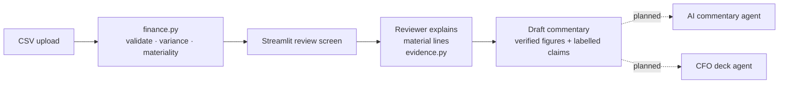

# FP&A Variance Assistant

[](https://github.com/casaikiran93-maker/fpa-variance-assistant/actions/workflows/tests.yml)
[](LICENSE)


**Month-end variance analysis that never invents a cause.** Upload actuals, budget and forecast. The tool validates the data, calculates variances in exact decimal arithmetic and flags material movements. It then asks the reviewer to explain each one. Figures come only from the engine; explanations come only from people and are labelled as such.

Version 0.2: rule-based commentary. AI commentary and a CFO slide-deck generator are next (see the [roadmap](docs/ROADMAP.md)).

<!-- Add a screenshot: save it as docs/screenshot.png and uncomment the line below. -->
<!--  -->

## Why it exists

During monthly reporting, FP&A teams reconcile actuals against budget or the latest forecast, pick out material movements and chase explanations. All of it is done under deadline pressure. The risk is commentary that sounds confident but restates numbers wrongly or guesses at causes. This project makes each step explicit, repeatable and reviewable.

## What it does

- **Validates before it calculates.** Missing values, duplicate keys, wrong currency, negative or malformed amounts and mixed months stop the analysis. Nothing is assumed.
- **Variance vs budget or forecast**, ranked by size, filterable by country.
- **Configurable materiality.** The amount **and** percentage thresholds must both be met; zero baselines use the amount only.
- **Reviewer explanations** per material line: reason, reference, amount explained, review status and timing (one-off, recurring or timing difference).
- **Explained vs unexplained.** Only *confirmed* notes reduce the unexplained balance. Unconfirmed and conflicting notes stay open.
- **Downloadable management commentary** that keeps verified figures separate from reviewer-supplied claims.

## How it works



| File | Role |
| --- | --- |
| `finance.py` | CSV validation, variance and materiality engine (Decimal only) |
| `evidence.py` | Reviewer notes, coverage arithmetic, evidence-aware commentary |
| `app.py` | Streamlit interface |
| `tests/` | 21 tests: engine, evidence rules and Streamlit AppTest UI checks |

## Run it locally

Requires Python 3.12 or 3.13. On Windows, open Command Prompt in the project folder:

```bat
py -3.13 -m venv .venv
.venv\Scripts\python -m pip install -r requirements.txt
.venv\Scripts\python -m streamlit run app.py
```

The app opens at http://localhost:8501 with fictional demo data loaded. No API key is needed. For a guided tour with expected figures, see the [walkthrough](docs/WALKTHROUGH.md).

Run the tests:

```bat
.venv\Scripts\python -m unittest discover -s tests -v
```

## Input format

Download **sample input** from the app sidebar and edit it in Excel (save as CSV UTF-8). Columns, in this order:

`month,country,account,currency,actual,budget,forecast`

- `month` is `YYYY-MM`, one month per file
- `currency` is `INR`; all countries are already translated (no FX conversion)
- Amounts are plain nonnegative numbers with at most 2 decimals: no currency symbols or thousands separators
- Each month/country/account/currency combination must be unique

## Calculation rules

- Variance = actual − baseline. Percentage = variance ÷ baseline × 100, calculated before display rounding.
- Positive expense variance is **unfavorable**; negative is **favorable**.
- Zero baseline → percentage is N/A; only the amount threshold applies. Zero movement is never material.
- Defaults: material when |variance| ≥ INR 50,000 **and** |%| ≥ 5%.
- Net variance can hide offsetting movements, so the total and the line detail are both shown.

## Limitations

Expense accounts only (no revenue or credits), one month per file, INR only. Accounts missing entirely from the upload can't be detected without an expected-account roster. Notes live in the browser session only. Reference labels are not fetched or verified, and "confirmed" is the reviewer's assertion. Full details are in [VERIFICATION.md](VERIFICATION.md).

## Roadmap

1. ✅ Engine, validation, reviewer explanations, tests
2. 🔜 Locked review pack + Excel/JSON export
3. AI commentary agent that asks follow-up questions on vague reasons and compiles structured commentary, with a number validator
4. CFO deck agent (python-pptx), running in parallel with the commentary agent on the same locked pack
5. Hosted demo

Full plan, tools and backlog: [docs/ROADMAP.md](docs/ROADMAP.md).

## Data and transparency

All sample data is synthetic. No employer data or internal methodology is included. The project was built with AI assistance; the finance rules and their limitations are documented so they can be reviewed. No production use, time savings or business results are claimed.

## License

[MIT](LICENSE)
